

SOFTWARE ENGINEERING / LAB 02

<h1>实验二：软件设计与建模</h1>
<h2>活动票务与报名系统</h2>

张科杰　｜　241870025

需求基线：实验一 requirements.md v0.2（2026/10/22）

设计稿日期：2026年11月9日

面向对象设计 · PlantUML · Inkscape UI 

# 1 项目概述与实验目标

本项目选择“活动票务与报名系统”，面向讲座、展览、演出和交流会等活动。系统以免费报名和入场资格管理为核心，支持参与者、组织者、检票人员、平台管理员四类角色。系统不涉及价格、支付、退款和选座，通知仅采用站内通知。

本实验把实验一的需求分析结果转换成可实现的软件设计：划分模块及其职责，建立对象与持久化关系，用 UML 展示静态结构、业务行为和对象交互，并设计覆盖所有功能模块的界面。

## 1.1 输入依据与设计标识

唯一业务基线是附件《活动票务与报名系统需求整理》v0.2，保留原 REQ-001～REQ-023 编号。附件中的业务规则作为分析材料；其中仓库地址和分支信息不等于要求本次修改或推送远程仓库。本次未访问或修改原远程仓库。

基线称已确认22条、待确认1条，其中功能需求17条、约束2条、非功能需求3条；REQ-023是额外的待确认非功能需求。

## 1.2 主要功能

1. 账号注册、登录及管理员角色分配；服务端角色与对象权限校验。
2. 活动、场次和票种配置，首次审核发布、重要修改重新审核、分级取消。
3. 按关键词、城市、类别、日期组合查询，登录报名、唯一凭证查询及个人取消。
4. 满额后主动候补、截止前退出候补，释放名额时按票种顺序自动递补，截止失效。
5. 指定场次检票授权，扫描或输入凭证，首次签到、重复提示及场次结束缺席处理。
6. 容量与签到统计，名单筛选和 CSV 完整导出。
7. 取消、重要修改生效与递补成功站内通知；关键操作日志记录和授权查询。
8. 事务一致性、正常重启持久化及后续确认的性能目标。

## 1.3 需求覆盖与模块映射

|需求|设计落点|UI 页面|说明|
|---|---|---|---|
|001|全局范围|02、03|不设计收费与第三方通知|
|002|M1 账号授权|01、13|注册不接受管理角色|
|003|M1 + 各模块对象权限|08、11、13、14|角色与归属共同校验|
|004|M2 活动管理|06、07|活动→场次→票种|
|005|M2 首次审核|06、12|驳回原因必填|
|006|M2 版本化变更|07、12|审核前使用原版本|
|007|M2 分级取消|06、07、12|原因、影响范围与历史保留|
|008|M3 活动发现|02|字段语义待确认|
|009|M3 报名凭证|03、04|幂等与有效占位唯一|
|010|M3 本人取消|04|截止前仅释放一次|
|011|M4 主动候补|03、04|满额主动加入、退出不释放正式名额|
|012|M4 自动递补|04、05|票种内 FIFO、截止失效|
|013|M5 验票签到|08、11|授权场次、唯一签到|
|014|M4 到期处理|04、09|正常结束场次未签到转缺席|
|015|领域模型与数据库|04、07、12|主外键、约束与历史保留|
|016|M6 统计|09|口径、零分母、取消场次|
|017|M6 名单导出|10|仅组织者本人活动|
|018|M7 站内通知|05|事务后投递、失败重试|
|019|M8 审计|14|至少180天、真实结果|
|020|API + M1|全部受限页|直接接口越权也拒绝|
|021|事务应用服务|03、04、11|并发、故障与重试一致性|
|022|PostgreSQL 持久层|跨模块|重启后业务与关系保留|
|023|查询索引与测量方案|02|暂定指标，不作通过结论|

# 2 架构与面向对象设计

## 2.1 总体架构选择与原因

采用“浏览器 UI → REST API → 应用服务与领域对象 → PostgreSQL”的分层模块化单体。前端负责交互和初步输入提示，后端统一进行身份、角色、归属、状态、时间与容量校验；Repository 封装持久化访问，领域服务处理跨对象规则。

课程原型规模适合单体部署，报名、递补、取消、签到共用数据库事务，便于保持一致性。若早期拆成独立微服务，需要额外处理跨服务一致性，不能直接靠本报告的数据库事务实现。模块边界仍保持清晰，便于后续扩展。

|模块|对象或服务|输入与输出|主要协作|
|---|---|---|---|
|M1 账号与授权|User、Role、AuthorizationService|账号、会话、对象权限判定|所有受限入口；组织者授权检票员|
|M2 活动与审核|Event、Session、TicketType、Review、ChangeRequest|有效活动版本、审核与取消结果|增容调用M4，变更/取消产生M7事件|
|M3 发现与报名|RegistrationService、CredentialQuery|查询结果、本人报名和凭证|调用共同事务服务与M4|
|M4 候补与定时任务|WaitlistService、DeadlineWorker|递补、候补失效、缺席|复用报名状态约束，产出通知事件|
|M5 验票与签到|CheckAuthorization、CheckInService|有效性判定、唯一签到结果|读取M1授权，锁定M2范围和报名|
|M6 统计与导出|StatisticsService、RosterExportService|授权统计与完整CSV|从统一持久化状态计算|
|M7 站内通知|OutboxDispatcher、Notification|三类业务通知、重试状态|只在业务提交后消费事件|
|M8 审计日志|AuditService、AuditQuery|操作人、时间、对象及结果|关键成功操作与业务同事务保存|

模块采用高内聚、低耦合设计。报名规则由统一应用服务执行，避免 UI、检票端和定时任务各自维护一套状态解释。策略接口承载尚未确认的查询、时间端点和统计规则，未确认前不据此制定验收结论。

## 2.2 对象职责与设计原则

Event 聚合场次与票种的业务归属，保存组织者与有效版本。Registration 封装报名状态和资格，候补递补继续使用原记录并签发凭证。CheckIn 仅保存成功签到事实，具有报名级唯一约束。Review 保存审核决定，ChangeRequest 单独保存拟修改快照和基准版本，避免待审核信息覆盖线上有效数据。

应用服务控制事务边界；授权策略先验证角色，再核对活动 ownerId、报名 userId 或具体场次授权。接口只接收业务意图，服务器不相信客户端上传的 ownerId、状态、占用数或管理角色。时间由服务器产生并在取得锁后再次读取，避免排队中的旧请求跨过截止仍被执行。

# 3 UML 类型理解与项目图示

## 3.1 UML 类型选用说明

下表给定分类说明各图用途。

|类别|图名|用途与本项目适用性|
|---|---|---|
|结构|类图|对象属性、关联和多重性；必画，展示领域模型|
|结构|对象图|某一时刻的对象实例和链接；可用于说明一场活动的具体报名快照|
|结构|组件图|组件职责与依赖；选用，说明八模块逻辑交互|
|结构|复合结构图|一个分类器内部的部件、端口和连接；可细化检票子系统|
|结构|部署图|软件制品到运行节点的分配；选用，说明持久化和任务部署|
|结构|包图|命名空间及包依赖；可用于后续代码目录划分|
|结构|剖面图|通过 stereotype、tag、constraint 扩展UML；本项目无需自定义元模型|
|行为|活动图|带分支与并行的工作流程；可进一步展开首次审核流程|
|行为|用例图|角色及系统提供的能力；选用，说明四角色功能边界|
|行为|状态图|对象状态及事件触发转换；选用，限制报名合法变化|
|交互|通信图|对象链接与编号消息；可强调检票对象间协作拓扑|
|交互|交互概览图|把多个交互片段连接成宏观流程；适合完整活动生命周期|
|交互|时序图 / 序列图|按时间展示消息和条件片段；选用，解释取消与递补事务|

本报告绘制六种互不重复的 UML：类图、组件图、部署图、用例图、状态图和时序图，所有图片由对应 PlantUML 源码实际渲染。

## 3.2 领域类图

结构性图。主线为 User→Registration→TicketType→Session→Event；Review 和 ChangeRequest 区分首次审核与重要修改，CheckIn 保存唯一签到事实。多重性允许草稿暂时没有场次；关联的生命周期归属不意味着可以级联删除历史。

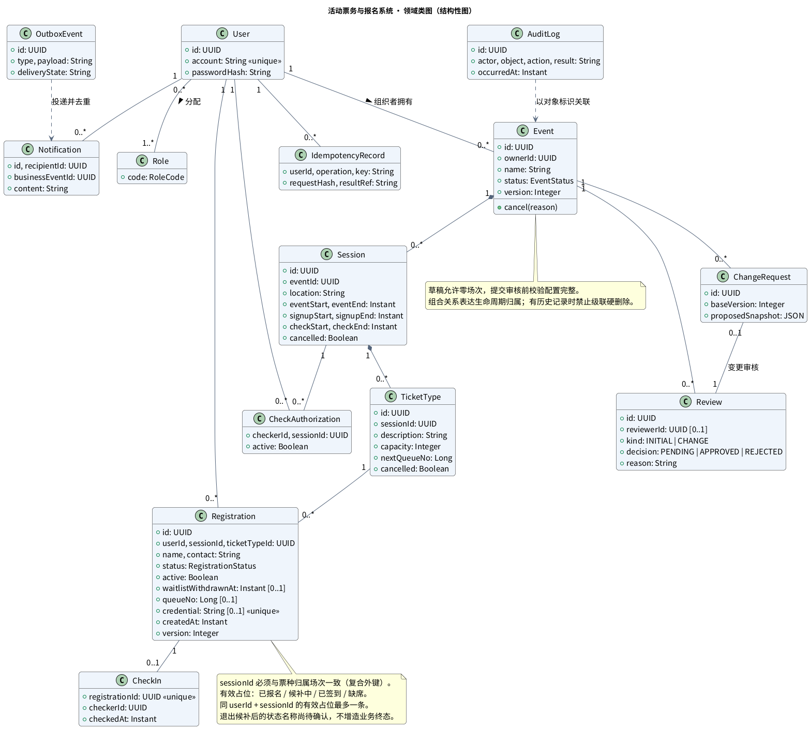

图源：UML/01_类图.puml。

## 3.3 模块架构组件图

结构性图。API 统一入口调用八个业务模块，事务服务承担跨模块原子变更，Worker 消费持久化事件。箭头表示调用、读取或依赖，标签说明用途，不表示独立网络服务。

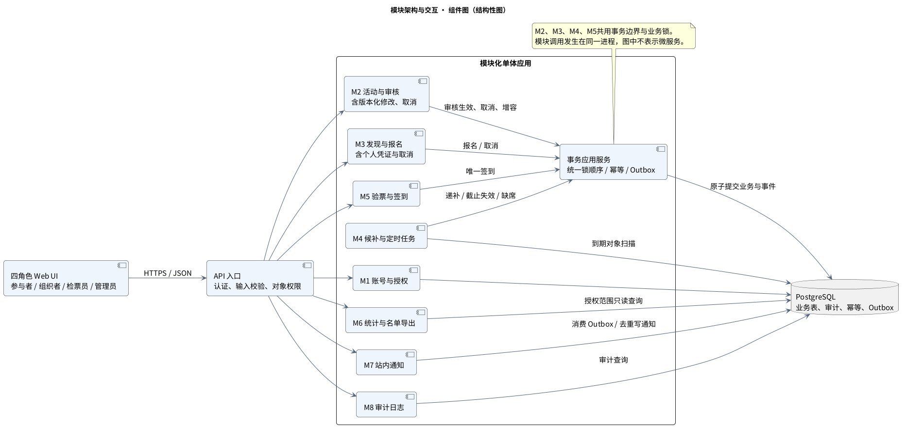

图源：UML/02_组件图.puml。

## 3.4 部署图

结构性图。浏览器通过 HTTPS 访问应用，应用进程和任务使用同一数据库。原型可合并主机，但必须使用持久化卷；浏览器缓存不能作为已保存业务的唯一来源。

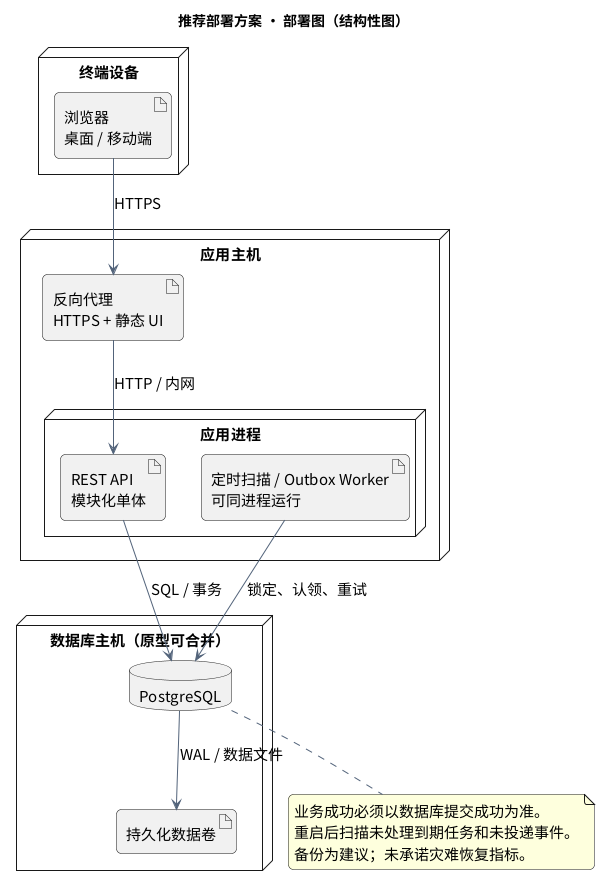

图源：UML/03_部署图.puml。

## 3.5 四角色用例图

行为性图。普通参与者不能执行平台管理；检票人员只进行授权场次的核验。管理员的统计权限不自动赋予其名单导出权限。角色兼任未确认，未设置角色继承。

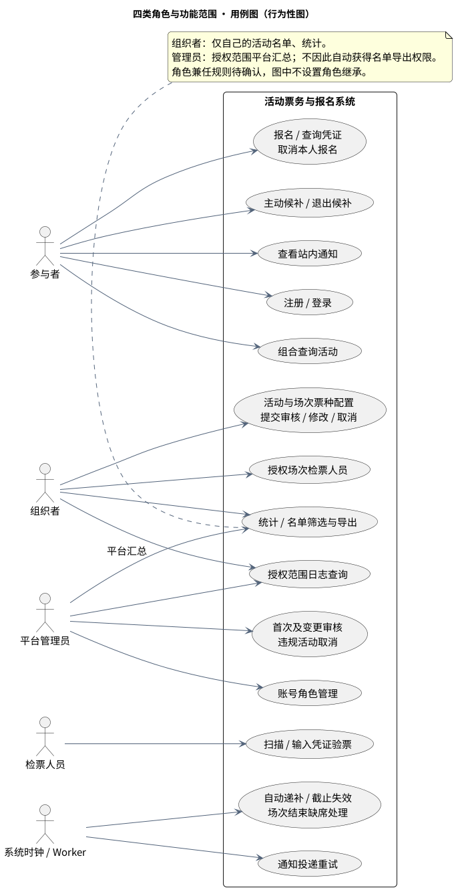

图源：UML/04_用例图.puml。

## 3.6 报名状态图

行为性图。候补不占容量，递补才进入已报名并签发凭证；已签到与缺席仍计入占用。取消只将已报名和候补中转为活动取消，先发生的签到事实保留。退出候补的终态不擅自命名，另以退出事件表示。

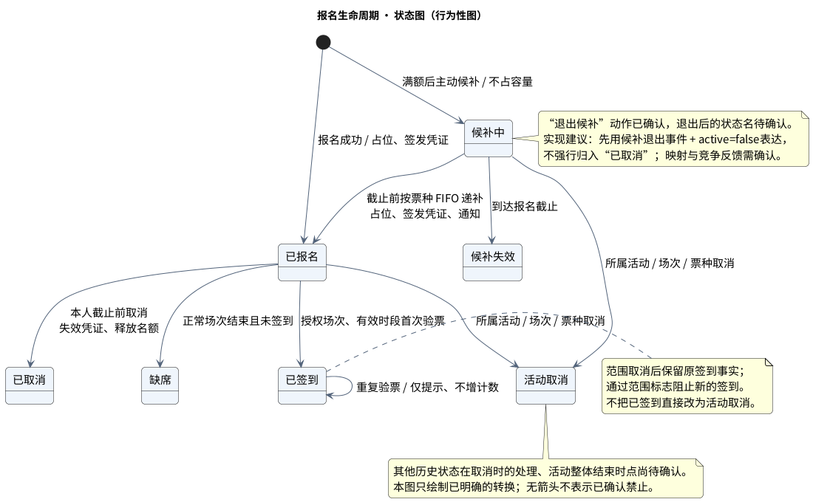

图源：UML/05_报名状态图.puml。

## 3.7 取消报名与递补时序图

交互性图。展示权限、幂等、统一锁顺序、截止复查、业务原子提交及通知重试。取消和递补不拆成可能丢失的两次内存操作；通知失败不回滚已经成功的业务。

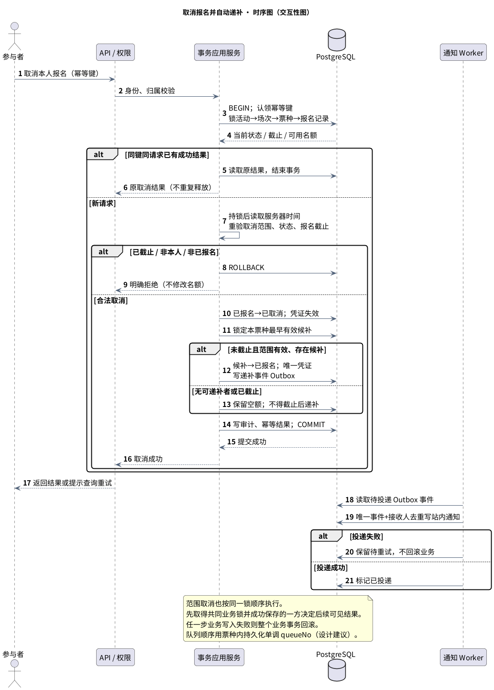

图源：UML/06_取消与递补时序图.puml。

# 4 UI 工具、规范与功能界面

使用 Inkscape 命令行导出工具处理可编辑 SVG 矢量画板，实际导出14张1440×1000 PNG。SVG是设计源文件，文字、色块、卡片和控件均可在 Inkscape 继续编辑。

视觉采用深色角色导航、蓝色主操作、浅色内容区，标题、筛选、结果和反馈自上而下组织。绿色表示成功，橙色表示候补或注意，同时用文字表达，避免只依赖颜色。登录和检票页优先突出单一主要操作；危险操作要求确认弹窗并展示原因与影响范围。所有演示姓名、活动、编号、日期和数量为示意，不是用户真实业务数据。

共用状态要求：加载中给出进度提示；空列表说明如何调整条件；失败保留输入并明确是否可重试；权限不足不给出敏感数据；响应丢失提示查询原结果。

## 4.1 登录与注册

**覆盖：M1；REQ-002、020。** 账号密码登录、普通注册。错误登录给出明确反馈；重复账号禁止创建，注册无管理角色选择。管理角色由管理员分配。

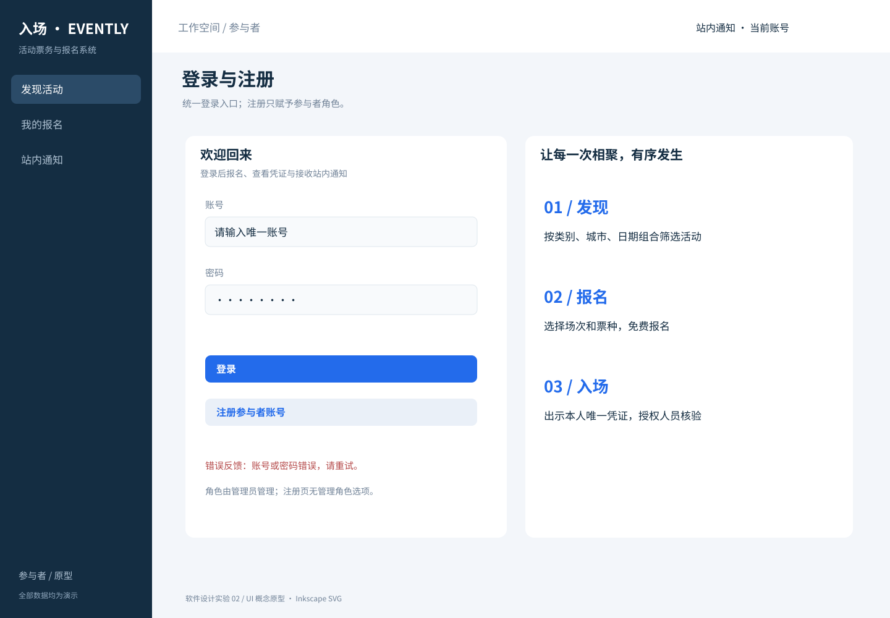

可编辑源：同目录同名 SVG；界面尺寸1440×1000。

## 4.2 活动发现

**覆盖：M3；REQ-008、023。** 组合筛选入口及结果卡片，查询条件按 AND 组合。日期范围已给出输入设计，日期语义待确认。空结果提示调整条件；关键词、城市、日期和状态语义待确认。

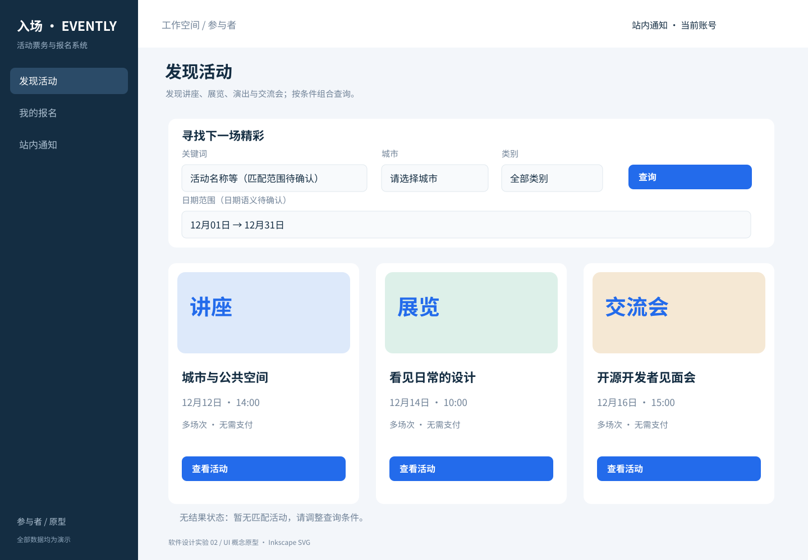

可编辑源：同目录同名 SVG；界面尺寸1440×1000。

## 4.3 活动详情与报名

**覆盖：M3/M4；REQ-004、009、011。** 选择场次、票种，填写姓名与联系方式，正式报名和主动候补分开。满额不能自动候补；提交时重新校验服务端状态、时间和名额。报名开始边界、联系方式格式待确认。

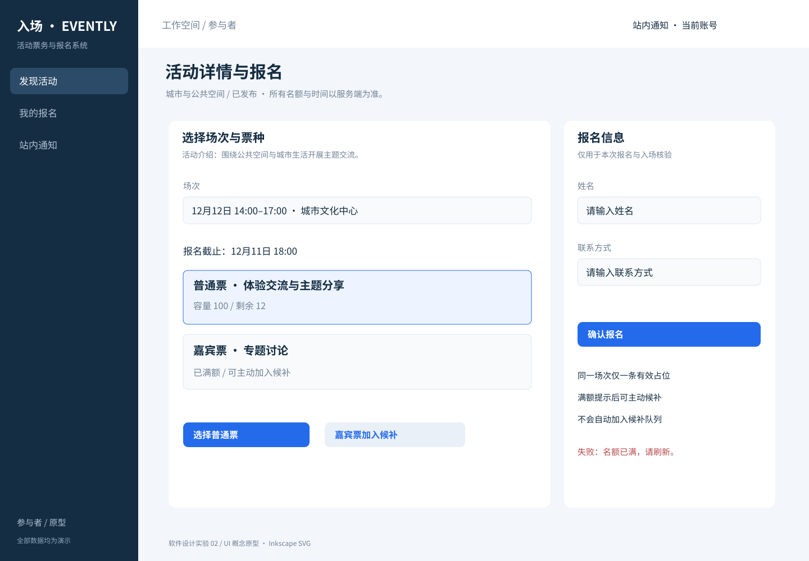

可编辑源：同目录同名 SVG；界面尺寸1440×1000。

## 4.4 我的报名与凭证

**覆盖：M3/M4；REQ-009～014。** 展示本人状态与唯一凭证，截止前可取消本人已报名或退出活跃候补。取消弹窗说明释放名额；签到后不能取消；候补无验票资格。当前示例为文字凭证，后续可补同内容二维码。

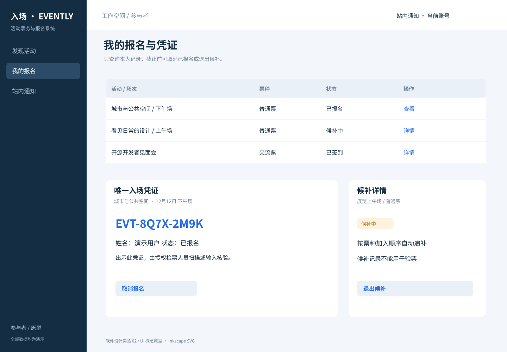

可编辑源：同目录同名 SVG；界面尺寸1440×1000。

## 4.5 站内通知

**覆盖：M7；REQ-018。** 三类事件展示影响、原因与跳转详情。只在业务成功后出现通知；失败重试由后台处理，不改变业务资格。已读标记不属于基线强制要求，本稿未以此作为验收点。

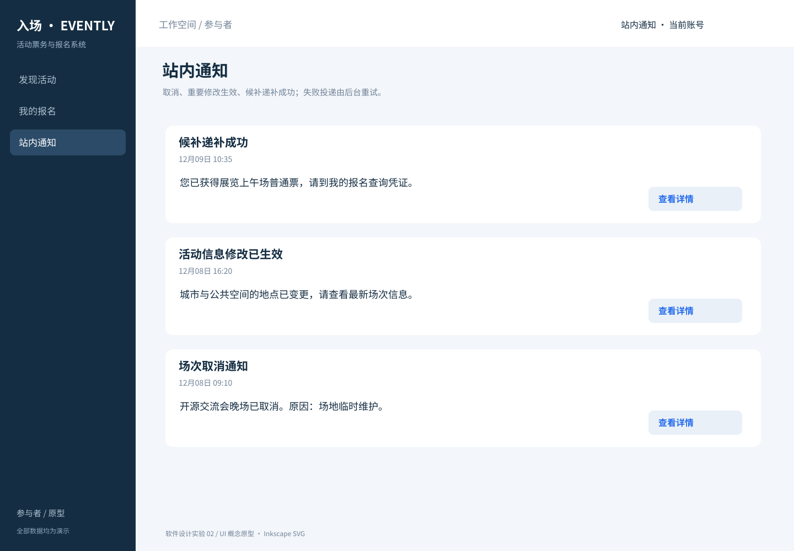

可编辑源：同目录同名 SVG；界面尺寸1440×1000。

## 4.6 组织者工作台

**覆盖：M2；REQ-003～007。** 只列本人活动，展示草稿、待审核、已驳回、已发布等状态并提供创建、管理入口。驳回详情给出原因，修改后重新提交。

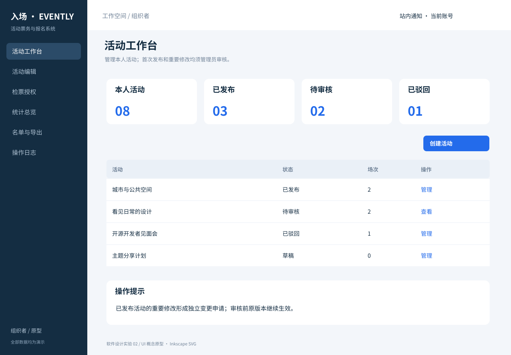

可编辑源：同目录同名 SVG；界面尺寸1440×1000。

## 4.7 活动与场次票种编辑

**覆盖：M2；REQ-004、006、007。** 编辑活动及一组场次票种配置，后续实现以可重复配置卡片支持多场次多票种。重要修改保存独立草案；时间和容量不合规时定位字段错误。取消须说明原因并区分活动、场次、票种范围。

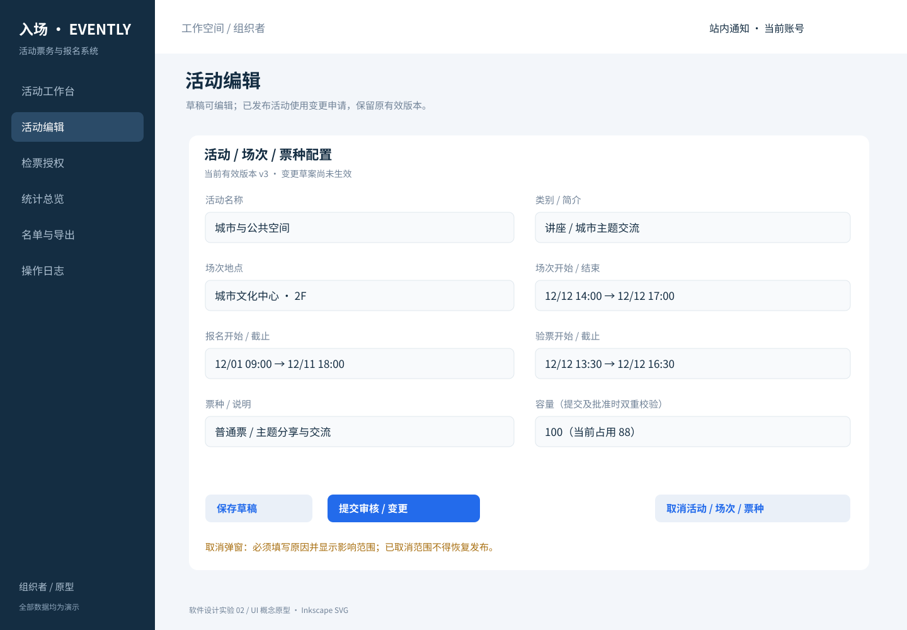

可编辑源：同目录同名 SVG；界面尺寸1440×1000。

## 4.8 场次检票授权

**覆盖：M1/M5；REQ-003、013。** 组织者选择自己的场次和检票账号进行授权，授权不传播到其他场次，也不赋予导出权限。授权撤销规则未明确，撤销操作暂不作为已确认交互。

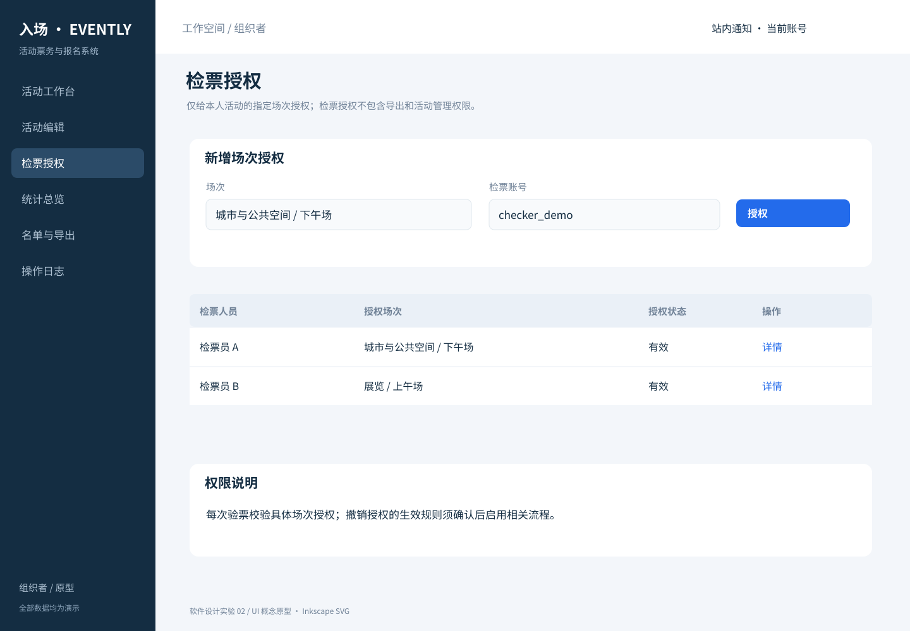

可编辑源：同目录同名 SVG；界面尺寸1440×1000。

## 4.9 统计总览

**覆盖：M6；REQ-016。** 组织者看本人活动；管理员复用同一统计组件展示授权平台范围，汇总维度待确认。占用与剩余采用明确口径；正常结束场次计算签到率，零分母显示暂无数据，取消场次不计算。

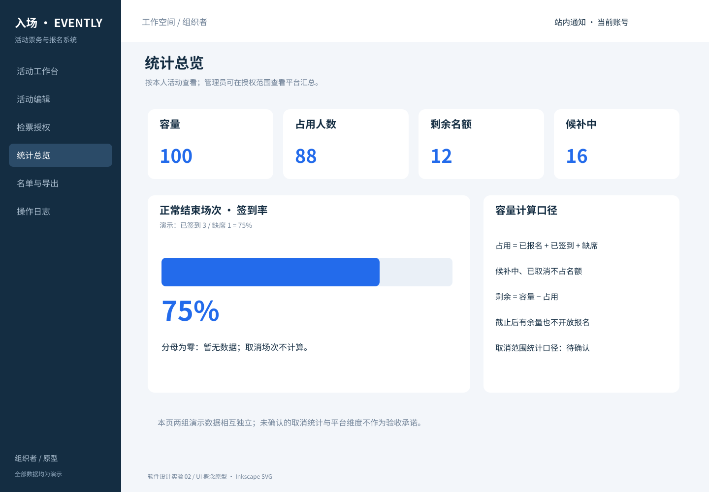

可编辑源：同目录同名 SVG；界面尺寸1440×1000。

## 4.10 名单筛选与导出

**覆盖：M6；REQ-017。** 按场次、票种、状态筛选本人活动名单，完整导出 CSV。导出失败不提供不完整的成功文件。字段、快照时点待确认；设计建议使用只读事务快照形成同次完整结果，并防CSV公式注入。

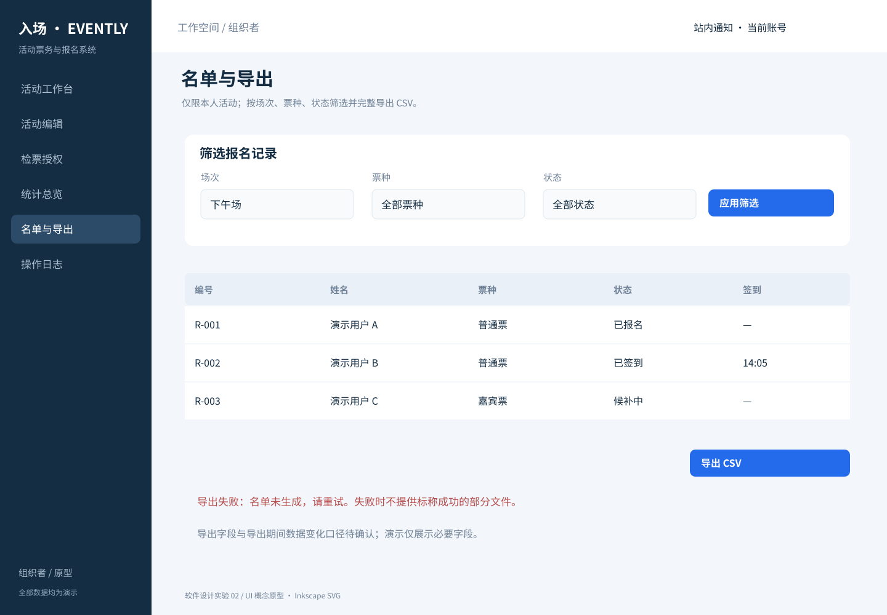

可编辑源：同目录同名 SVG；界面尺寸1440×1000。

## 4.11 现场检票

**覆盖：M5；REQ-013、020、021。** 选授权场次后扫描或手动输入。成功、重复、未授权、时段外、已取消、无效资格有不同文字结果。摄像头不可用提供手动输入；并发核验只计数一次。

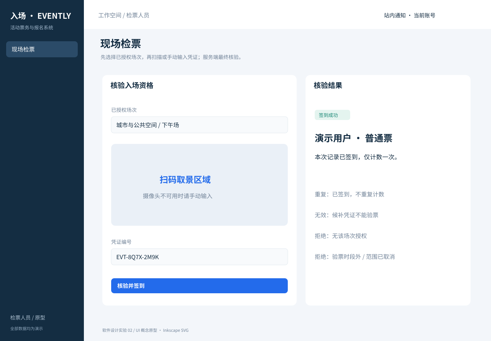

可编辑源：同目录同名 SVG；界面尺寸1440×1000。

## 4.12 管理员审核

**覆盖：M2；REQ-005～007。** 对比线上有效版本和拟修改内容，执行通过或附原因驳回。批准前再次检查容量、活动范围与版本。违规活动取消单独确认，不能直接使旧变更覆盖已取消活动。

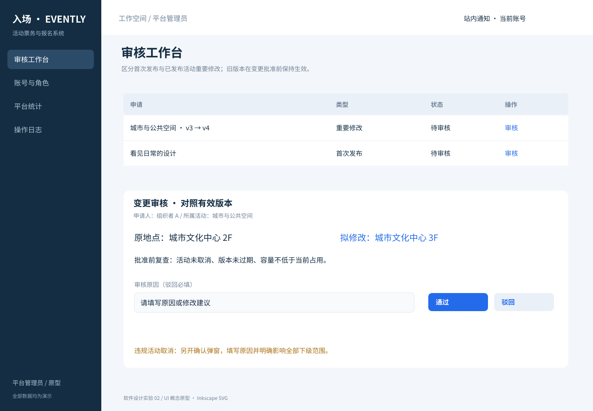

可编辑源：同目录同名 SVG；界面尺寸1440×1000。

## 4.13 账号与角色管理

**覆盖：M1；REQ-002、003、020。** 管理员查询账号并分配角色，提交确认展示目标账号和角色。服务端拒绝普通用户直接发起角色分配。角色兼任及撤销处理待确认，不擅自设定。

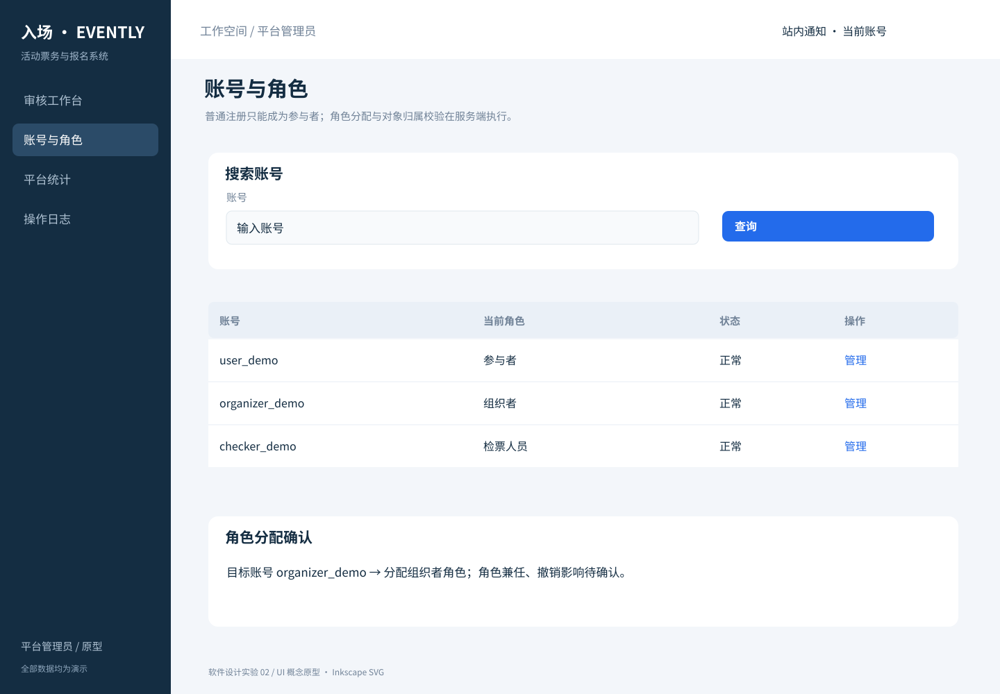

可编辑源：同目录同名 SVG；界面尺寸1440×1000。

## 4.14 审计日志查询

**覆盖：M8；REQ-019。** 按时间、操作人、类型查询真实结果；组织者入口复用列表但服务器只返回本人活动记录。保留至少180天，不等于第180天立即删除；自动任务主体标识待确认。

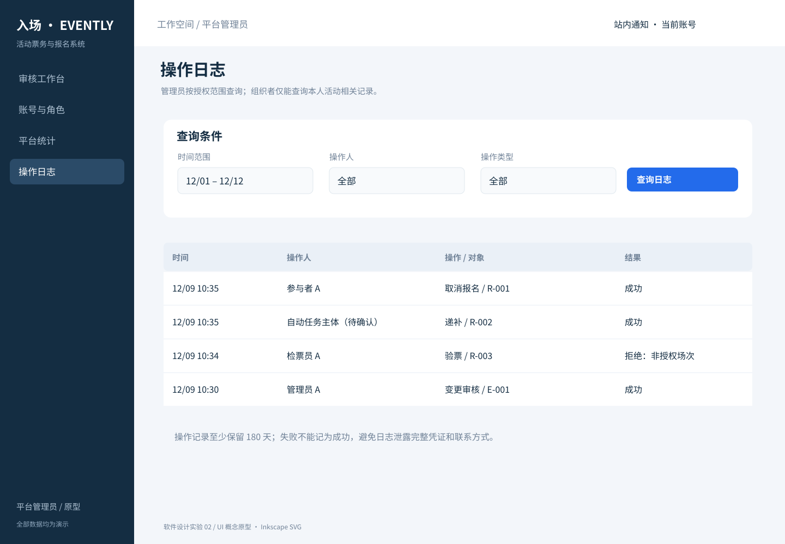

可编辑源：同目录同名 SVG；界面尺寸1440×1000。

# 5 大模型辅助工具使用过程与反思

### 1 使用场景

在实验过程中，借助Codex辅助完成系统功能模块梳理、UML模型设计及UI原型开发。利用PlantUML生成相关设计图，并通过本地浏览器预览系统界面，对页面布局和业务操作流程进行检查。

### 2 生成结果

在Codex的辅助下，完成了系统类图、组件图、状态图和时序图的绘制，并设计了活动报名、活动审核、检票签到等核心功能的界面原型。同时保留了相关源文件，并将设计图导出为图片，便于后续修改和实验报告编写。

### 3 优缺点分析

Codex能够根据需求快速生成设计图和界面代码，有效提高开发效率，同时有助于保持界面风格统一，完善异常情况的处理。但其生成内容仍可能存在模块关系不准确、业务逻辑不完整以及数据不一致等问题，因此需要结合需求文档进行人工检查和调整。

### 4 修改优化后的结果

针对初步生成结果中存在的问题，对组件图中的模块依赖关系进行了调整，完善了不同页面之间的传递逻辑。此外，对实验报告的排版进行了优化，将相关功能界面集中展示，并对尚未明确的业务规则保留相应说明，使最终成果更加规范、完整。

### 5思考

通过本次实验，我对大模型在软件设计过程中的作用有了更加具体的认识。大模型能够辅助开发者梳理需求、划分功能模块，并快速生成UML设计图和界面原型，从而减少重复性工作，提高设计效率。同时，借助大模型还可以检查不同设计成果之间的一致性，发现可能遗漏的业务流程和异常情况，为后续优化提供参考。但大模型生成的内容并不一定完全符合实际需求，部分设计可能存在逻辑错误或细节缺失。因此，在使用过程中，需要明确提出设计要求和约束条件，并结合需求文档对生成结果进行验证和修改。总体而言，大模型更适合作为辅助设计和提高效率的工具，而不能完全替代开发者的独立思考与判断。
